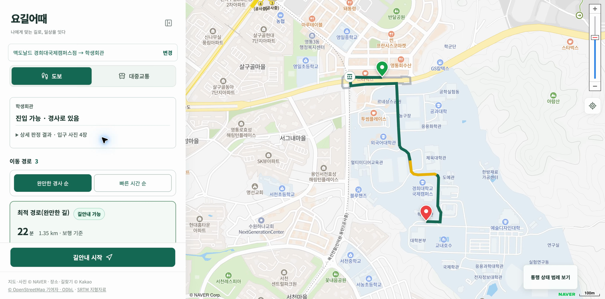
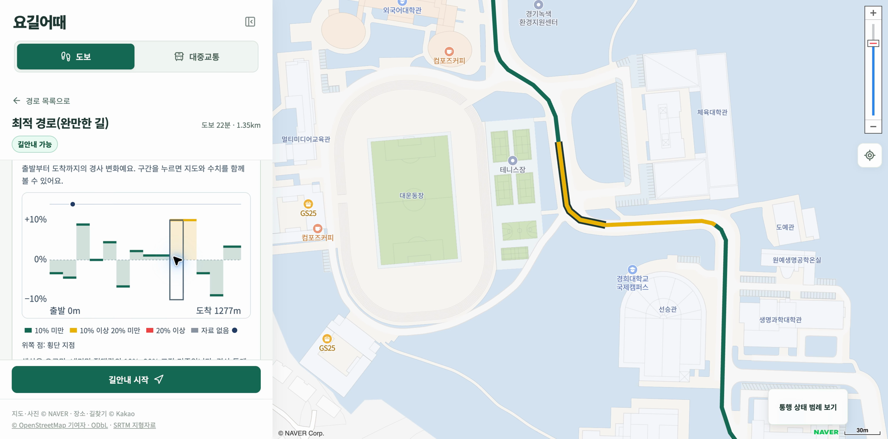
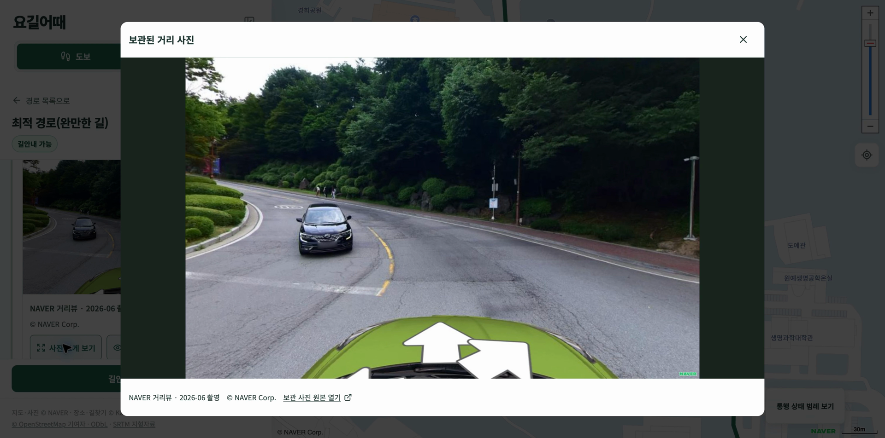
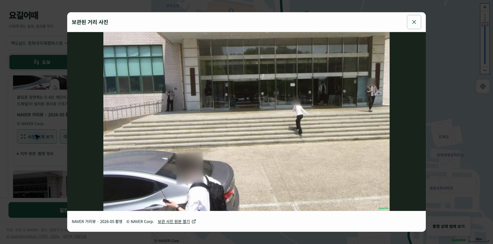
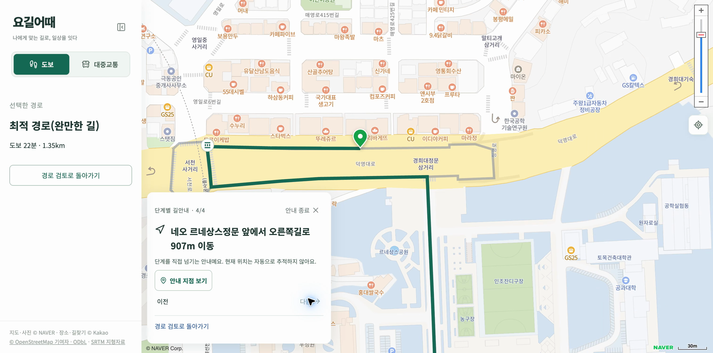
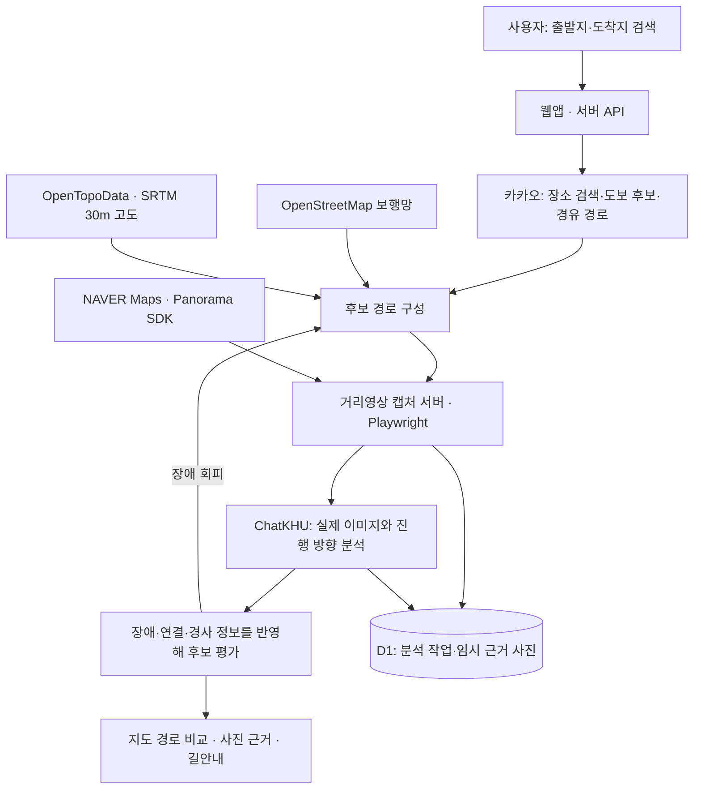

# 요길어때

**거리영상을 AI로 분석해 교통약자의 이동에 적합한 길을 찾는 웹앱입니다.**

출발지와 도착지를 검색하면 실제 도보 후보 경로를 불러옵니다. 지형 경사와 거리사진 속 계단·단차·통행 공간을 분석하고, 사용자는 지도에서 경로를 비교하며 사진 판정 근거를 확인할 수 있습니다.

대규모 배리어프리 데이터베이스를 먼저 구축하는 대신, 요청한 경로의 영상을 서버에서 확보해 ChatKHU API로 분석하는 방식입니다.



맥도날드 경희대국제캠퍼스점 → 경희대학교 국제캠퍼스 학생회관 시연 화면입니다.

## 구현된 기능

| 기능 | 현재 동작 |
| --- | --- |
| 장소 검색 | 출발지·도착지 검색 결과를 선택하고 지도에서 위치 확인 |
| 도보 경로 비교 | 실제 후보를 조회하고 중복 선형을 합쳐 최단 경로·최적 경로(완만한 길)·다른 경로로 표시 |
| 경사도 표시 | 후보별 지형 고도를 조회해 구간 경사 프로필과 지도 선의 색상으로 표시 |
| 경로 정렬 | 완만한 경사 순 또는 빠른 시간 순으로 후보 비교 |
| 거리사진 AI 분석 | 경로의 진행 방향과 관찰 대상을 전달해 계단·단차·통행 공간을 판독 |
| 추가 관찰 | 가림이나 구도 문제에 따라 앞뒤 위치·다른 화각의 사진을 확보하고 함께 재판독 |
| 대체 경로 탐색 | 확인된 장애 구간을 피하도록 보행망의 횡단 지점과 경유지를 활용해 전체 후보 경로를 다시 조회 |
| 도착지 접근로 확인 | 선택 위치를 바라보는 여러 사진에서 경사로 등 진입 구조를 관찰하고 상세 근거 제공 |
| 근거 사진 보기 | 지점별 사진·촬영 월·판정 결과·원본 거리뷰를 상세 화면에서 확인 |
| 단계별 길안내 | 선택 경로의 이동 지점을 지도에 표시하고 이전·다음 버튼으로 안내 확인 |
| 대중교통 | 도보·대중교통 탭 전환과 ODsay 경로 조회 연결. 실제 조회에는 별도 키 필요 |

경사 색상은 오르막과 내리막에 같은 기준을 적용합니다. 경사 절댓값 **10% 미만은 초록**, **10% 이상 20% 미만은 노랑**, **20% 이상은 빨강**입니다.

현재 화면은 경사 기준에 따른 후보 정렬을 제공합니다. 사용자가 허용 경사도를 직접 입력하는 설정 화면과 실시간 위치 추적·이탈 재탐색은 구현하지 않았습니다.

## 실제 앱 화면

아래 화면은 2026-10-30에 촬영한 실제 앱 시연 영상에서 추출했습니다. 사진 공급자의 출처 표시는 원본 화면에 포함되어 있습니다.

| 구간별 경사 확인 | 거리사진 관찰 |
| --- | --- |
| [](docs/images/terrain-profile.png) | [](docs/images/streetview-evidence.png) |
| 경사 그래프에서 구간을 선택하면 지도에서도 같은 위치를 강조합니다. | 관찰 지점을 선택해 실제 거리사진과 AI 판정 근거를 확인합니다. |

| 도착지 경사로 확인 | 단계별 길안내 |
| --- | --- |
| [](docs/images/entrance-ramp.png) | [](docs/images/navigation.png) |
| 간단한 진입 결과 아래에서 사진과 상세 판정을 펼쳐봅니다. | 선택한 경로의 다음 이동 지점을 확인합니다. |

## 처리 흐름



지도 표시와 기본 거리영상은 NAVER, 장소 검색과 기본 도보 후보 조회는 카카오를 사용합니다. OSM은 횡단보도·보행 연결·계단 등 보조 정보를 제공하며, 수치 경사도는 OpenTopoData의 SRTM 30m 지형자료로 계산합니다. AI는 사진에서 보이는 이동 구조를 판독합니다.

기술 구성은 React·TypeScript·vinext·Vite, Cloudflare Worker·D1, Node.js·Playwright, Python·SQLite입니다.

## 로컬에서 실행하기

아래 명령은 macOS 또는 Linux 셸을 기준으로 합니다. Node.js **22.18 이상**, npm, Python 3, Git이 필요합니다. 사진 분석까지 사용하려면 API 키와 거리영상 캡처 서버, OSM 보행망 서버를 준비하세요.

### 1. 저장소와 의존성 준비

```sh
git clone https://github.com/justpastmarch/yogil-eottae.git
cd yogil-eottae
npm run install:ci
cp .env.example .env.local
npm --prefix services/roadview-renderer ci
npx --prefix services/roadview-renderer playwright install chromium
```

Linux에서 브라우저 실행에 필요한 시스템 라이브러리가 없다면 마지막 명령에 `--with-deps`를 추가합니다.

### 2. API 키 설정

`.env.local`에 아래 값을 채웁니다. `ROADVIEW_RENDERER_TOKEN`은 직접 만든 24자 이상의 임의 문자열이며, 앱과 캡처 서버가 같은 값을 사용합니다.

```dotenv
NAVER_MAP_CLIENT_ID=발급받은_클라이언트_ID
KAKAO_REST_API_KEY=발급받은_REST_API_키
CHATKHU_API_KEY=발급받은_ChatKHU_API_키
CHATKHU_MODEL=gemini-3.8-flash
ROADVIEW_RENDERER_URL=http://127.0.0.1:3101/capture
ROADVIEW_RENDERER_TOKEN=직접_생성한_24자_이상_토큰
OSM_OVERPASS_URL=http://127.0.0.1:8789/api/interpreter
```

| 설정 | 용도·준비 사항 |
| --- | --- |
| `NAVER_MAP_CLIENT_ID` | NAVER Cloud Maps의 Dynamic Map 활성화. 웹 서비스 URL에 `http://localhost:3000` 등록. 지도와 Panorama SDK에서 사용 |
| `KAKAO_REST_API_KEY` | 장소 검색·도보 후보·경유지 경로 조회. 현재 도보 연동을 이용할 수 있는 키와 접근 권한 필요 |
| `CHATKHU_API_KEY` | 실제 거리사진 분석. ChatKHU API Gateway에서 발급하고 사용 가능한 크레딧 준비 |
| `CHATKHU_MODEL` | 기본값 `gemini-3.8-flash`. 현재 어댑터는 Gemini·Claude 계열을 처리하므로 해당 계열의 이미지 입력 가능한 모델 ID 사용 |
| `ROADVIEW_RENDERER_URL` | 캡처 서버의 `/capture` 주소 |
| `ROADVIEW_RENDERER_TOKEN` | 캡처 서버 인증. `node -e "console.log(require('node:crypto').randomBytes(32).toString('hex'))"`로 생성 가능 |
| `OSM_OVERPASS_URL` | 아래에서 준비하는 로컬 보행망 조회 주소 |
| `ODSAY_API_KEY` | 선택 사항. 대중교통 탭의 실제 버스·지하철 경로 조회 |

현재 카카오 어댑터는 `dapi.kakao.com/v2/routing/walk`를 호출합니다. 일반 REST API 키 발급만으로 이 도보 엔드포인트의 접근 권한까지 보장되지는 않으므로 계정의 실제 응답을 확인해야 합니다. 카카오 키를 비우고 `TMAP_API_KEY`를 설정하면 TMAP 경로 어댑터를 사용합니다. 제공자를 선택한 뒤 요청 오류가 났을 때 다른 제공자로 자동 전환하지는 않습니다.

NAVER Client Secret과 카카오 JavaScript 키는 현재 지도 화면에 필요하지 않습니다. `.env.local`은 Git에서 제외됩니다. 값을 바꾼 뒤에는 앱과 캡처 서버를 재시작하세요.

### 3. 로컬 분석 DB 초기화

처음 설치할 때 빌드로 Wrangler 설정을 생성한 뒤 아래 두 마이그레이션을 순서대로 적용합니다.

```sh
npm run build
node --import ./scripts/sites-env.mjs ./node_modules/wrangler/bin/wrangler.js d1 execute DB --local --config dist/server/wrangler.json --persist-to .wrangler/state --file drizzle/0000_aromatic_skullbuster.sql
node --import ./scripts/sites-env.mjs ./node_modules/wrangler/bin/wrangler.js d1 execute DB --local --config dist/server/wrangler.json --persist-to .wrangler/state --file drizzle/0001_journey_captures.sql
```

두 SQL 파일은 분석 작업과 근거 사진 테이블을 만듭니다. 이미 초기화한 DB에는 같은 SQL을 다시 실행하지 마세요. 로컬 데이터는 `.wrangler/state`에 저장됩니다.

### 4. OSM 보행망 준비

대한민국 OSM 추출본을 내려받아 보행망 인덱스를 만듭니다. 데이터 다운로드와 인덱스 생성은 처음 한 번 필요하며, 이후 자료를 갱신할 때 다시 수행합니다. 원본과 인덱스는 저장소에 포함하지 않습니다.

```sh
mkdir -p .sites-runtime
python3 -m venv .sites-runtime/osm-venv
.sites-runtime/osm-venv/bin/python -m pip install osmium==4.3.2
curl -L --fail -o .sites-runtime/south-korea-latest.osm.pbf https://download.geofabrik.de/asia/south-korea-latest.osm.pbf
.sites-runtime/osm-venv/bin/python scripts/prepare-osm-extract.py .sites-runtime/south-korea-latest.osm.pbf .sites-runtime/south-korea-pedestrian.sqlite
```

### 5. 세 서비스를 각각 실행

세 터미널에서 아래 프로세스를 유지합니다. 모두 저장소 최상위 폴더에서 실행합니다.

**터미널 A · 앱**

```sh
npm run dev
```

**터미널 B · 거리영상 캡처**

```sh
node --env-file=.env.local services/roadview-renderer/server.mjs
```

**터미널 C · 보행망 조회**

```sh
.sites-runtime/osm-venv/bin/python services/osm-extract/server.py .sites-runtime/south-korea-pedestrian.sqlite
```

브라우저에서 **http://localhost:3000**을 엽니다. 캡처 서버는 `http://127.0.0.1:3101/health`에서 `{"ok":true}`를 반환하고, 보행망 서버는 시작 시 `OSM extract ready`를 출력합니다.

처음 경로를 조회하면 후보가 먼저 표시되고 사진 확보·분석이 이어집니다. 근거 사진은 경로 상세에서 열어볼 수 있습니다. 지도 도메인 등록 오류, 캡처 서버 연결 실패, ChatKHU 크레딧 부족은 각각의 연결 상태를 확인하세요.

## MVP 사용 시나리오

1. 출발지에서 **맥도날드 경희대국제캠퍼스점**을 검색해 선택합니다.
2. 도착지에서 **경희대학교 국제캠퍼스 학생회관**을 검색해 선택합니다.
3. **길찾기**를 누르고 후보의 시간·거리·추정 경사와 분석 결과를 비교합니다.
4. **최적 경로(완만한 길)**의 상세에서 경사 그래프와 구간별 거리사진을 확인합니다.
5. 도착지의 **상세 판정 결과**를 펼쳐 입구 경사로 사진을 확인합니다.
6. **길안내 시작**을 누르고 **안내 지점 보기**, **이전**, **다음**으로 이동 지점을 확인합니다.

화면에 표시되는 시간·거리·사진 판정은 실제 외부 응답과 분석 시점에 따라 달라집니다.

## 검증

```sh
node --test tests/*.test.ts
python3 tests/osm-extract.test.py
npm --prefix services/roadview-renderer test
npx tsc --noEmit --incremental false
npm run build
```

2026-10-30 GitHub 최초 업로드 시 앱 테스트 391개와 타입 검사를 통과했습니다. 이 README 정리 과정에서는 빌드와 빈 로컬 DB의 마이그레이션 실행을 확인했습니다. 실제 서비스 연결 검증에는 키와 실행 중인 세 서비스가 필요하며 외부 API 사용량이 발생합니다.

## 현재 적용 범위

- SRTM 30m 자료는 지형의 경사 추정에 사용합니다. 짧은 입구 경사로, 보도 단차, 지하보도 내부의 실제 경사각을 측정하는 자료는 아닙니다.
- 사진 판정은 촬영된 시점과 관찰 범위에 해당합니다. 사진 미확인과 실제 장애 관찰은 구분하며, 남은 분석 상태는 상세에 보존합니다.
- 현재 길안내는 버튼으로 단계를 넘기는 방식입니다. 대중교통 후보는 일반 경로이며 환승 구간 전체의 접근성은 검증하지 않습니다.
- 지도·거리사진·도보 경로 공급원의 이용 조건과 저장·AI 분석 허용 범위는 운영 전에 확인해야 합니다. 공개 소스 저장소가 외부 콘텐츠의 재사용 권한을 부여하지는 않습니다.
- 배포 시 D1 바인딩과 마이그레이션, API 비밀값, 등록 도메인, HTTPS 캡처 서버, 보행망 서버를 별도로 구성해야 합니다. `npm start`는 빌드된 Worker의 로컬 실행 명령입니다.

## 코드 안내

| 경로 | 역할 |
| --- | --- |
| `app/` | 검색·지도·경로 비교·사진 근거·길안내 화면과 API 엔드포인트 |
| `lib/` | 외부 서비스 연동, 경로·경사·장애 판정, 비동기 분석 작업 |
| `services/roadview-renderer/` | 실제 Panorama 화면 캡처 서버 |
| `services/osm-extract/` | 로컬 OSM 보행망 조회 서버 |
| `scripts/prepare-osm-extract.py` | OSM 원본에서 보행망 인덱스 생성 |
| `db/`, `drizzle/` | D1 스키마와 SQL 마이그레이션 |
| `tests/`, `scripts/verify-*.mjs` | 로직 테스트와 실제 앱 검증 도구 |

세부 구현과 검증 이력은 [SERVICE_RUNTIME.md](SERVICE_RUNTIME.md), 캡처 서버의 설정·응답 규약은 [renderer README](services/roadview-renderer/README.md)를 참고하세요. OpenStreetMap 자료는 [© OpenStreetMap 기여자 · ODbL](https://www.openstreetmap.org/copyright), 지형 고도는 [OpenTopoData SRTM](https://www.opentopodata.org/datasets/srtm/)을 사용합니다.
